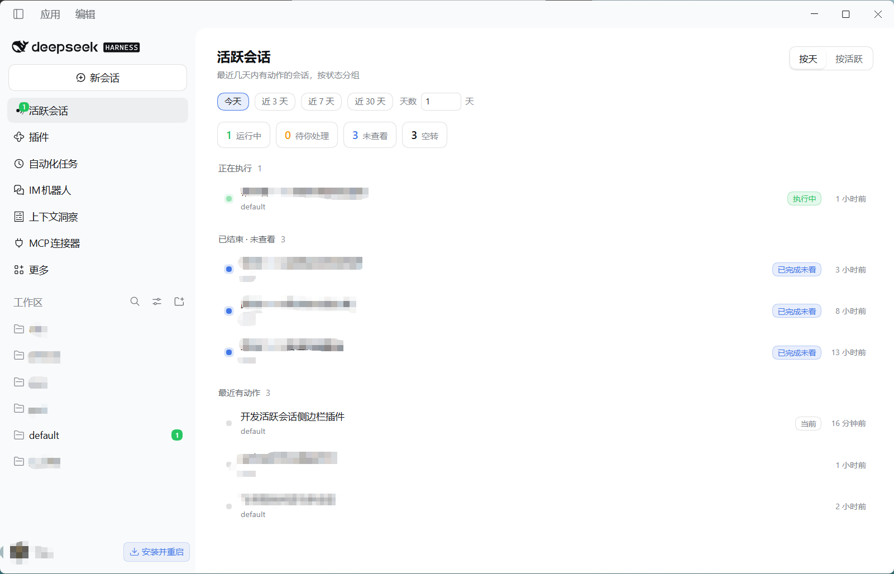

# dsh-active-sessions · 活跃会话

> DeepSeek Harness 插件：在左侧栏顶部和每个工作区标题上，实时显示哪些会话在跑、哪些在等你处理、哪些已经跑完但你还没看。



上图：侧栏顶部是插件入口（图标带活跃数气泡），主区是面板本体，按状态分成「正在执行 / 已结束·未查看 / 最近有动作」三组；左下角 `default` 工作区行右端的绿色「1」就是工作区角标。

左侧栏多一个入口，排在 **插件** / **自动化任务** 之上，用来回答一个问题：**现在到底有哪些会话在跑，哪些在等我。**

DSH 里多个工作区、每个工作区几十个会话，并行开工以后很难知道谁在动、谁卡在等确认、谁跑完了我还没看。这个插件把这三类直接提到侧栏顶部，点进去是一块完整面板。

## 特性一览

| 能力 | 说明 |
|---|---|
| 侧栏入口 | 排在所有全局面板最上面，图标带活跃数气泡（运行中 + 待确认） |
| 工作区角标 | 每个工作区标题行右端显示该区活跃数，运行中绿色、待确认橙色 |
| 按天视角 | 默认今天，可切 3 / 7 / 30 天或手输 1–365 天 |
| 按活跃视角 | 只看运行中 / 待确认 / 已结束未查看，不看时间 |
| 搜索会话 | 默认按标题本地过滤；一键切换搜消息正文，带原文片段与高亮 |
| 一键跳转 | 点任意一行直接打开该会话，主区自动切回对话 |
| 零新增接口 | 全部读现有投影，和侧栏的状态点是同一份数据 |

## 环境要求

- DeepSeek Harness `0.2.2-rc.1` 或更新
- Node.js `>= 22.19`

## 侧栏入口

- 位置：全局面板列表最上面（`order: -10`，排在 插件 0 / 自动化任务 10 / 上下文洞察 20 之前）
- 图标上挂一个数字气泡：**运行中 + 待你处理** 的会话数。有待确认时气泡转成橙色，否则绿色；为 0 时不显示。
- 侧栏收起成 56px 竖条时，入口仍然在，悬停出 tooltip「活跃会话」。

## 工作区角标

每个工作区标题行的右端会显示一个数字角标，统计**这个工作区里正在执行 + 等你处理**的会话数：

- 有会话在跑 → 绿色，带轻微呼吸动画（`prefers-reduced-motion` 下静止）
- 有会话在等你 → 橙色（等待优先于运行着色，因为那是真正卡住你的那一个）
- 都没有 → 不显示角标，不是显示 `0`
- 侧栏收起成竖条时自动隐藏（行内只剩图标，角标会挤在一起）

口径和主面板一致：只数运行中和待确认，跳过子代理会话、空白会话和已归档会话。「未分组」行不显示角标，因为它不是一个工作区。

### 为什么用 DOM 属性而不是插槽

`ui-workspace` 的工作区行**没有提供任何可挂载内容的插槽**——只有会话行有 `sidebar.session.row.leading` / `.trailing` / `.hover` 三个。工作区行本身就是 `ProjectRow` 内部渲染的 `div[role=treeitem]`，插件拿不到它的 React 子树。

所以这里走「后置标注」：一个零渲染组件挂在 `shell.overlay` 里，每次会话状态变化时算出各工作区的计数，找到对应的 `[data-row-key="workspace:<key>"]` 行，写上 `data-as-count` / `data-as-tone`；角标本身由本插件的 CSS 用 `::after` 画出来。

这样做的好处是不碰 React 的树、不会被下一次 render 抹掉，也不需要 monkey-patch 任何组件；代价是依赖 `data-row-key` 这个属性名（它是 ui-workspace 为拖拽和右键菜单加的稳定标识）。**如果哪天 DSH 升级改掉了这个属性，角标会静默消失，而不会报错或弄坏侧栏。**

## 面板

顶部两个视角切换，选择会持久化到 `localStorage`（键 `dsh-active-sessions:settings`）。

### 按天（默认）

- 默认 **今天**，即本地时间当天 0 点起
- 快捷预设：今天 / 近 3 天 / 近 7 天 / 近 30 天
- 右侧「天数」可以手输 1–365，改完立即生效
- 窗口内按状态分四组：**正在执行** → **等你处理** → **已结束 · 未查看** → **最近有动作**

#### 时间窗只筛「空转」，不筛活跃状态

这一条值得单独说明，因为它曾经是个 bug。

时间窗按会话的 **最后活动时间**（`updatedAt`，即最后一次用户消息）来划分。一个会话在 23:50 启动、跨过零点仍在运行，它的 `updatedAt` 还停在昨天——如果按窗口硬筛，它就会从「今天」里整个消失，而这恰恰是此刻最该被看见的那一个。

所以规则是：

| 状态 | 受时间窗约束？ | 理由 |
|---|---|---|
| 正在执行 | ❌ 不受 | 它是"此刻正在发生"，不是历史 |
| 等你处理 | ❌ 不受 | 同上，而且卡着你的就是它 |
| 已结束 · 未查看 | ❌ 不受 | 你还没处理完，属于待办 |
| 空转 | ✅ 受 | 纯历史记录，就该按日期归档 |

也就是说：**跨天正在跑的会话永远显示在「今天」，而昨天那些已经空转的会话不会赖着不走。**

### 按活跃

不看时间窗，只看真正需要你注意的三类：

- **正在执行**（自己或子代理在跑）
- **等你处理**（等批准 / 等确认计划 / 等你回答）
- **已结束 · 未查看**（跑完了，但那个会话你没打开过）

没有内容时显示「现在没有在跑、待确认或未查看的会话」，而不是一片空白。

### 每一行

```
● 会话标题                     [等批准] [当前]  3 分钟前
  工作区 · 2 个子代理在跑
```

- 状态点：绿=执行中（带呼吸动画）、橙=待确认、蓝=已完成未看、灰=空转
- 徽标直接写清楚在等什么：等批准 / 等确认计划 / 等你回答 / 已完成未看
- 点一行 → 打开那个会话（走 `uiWorkspace.openSession()`，自动把主区切回对话）

## 搜索

面板顶部有一个搜索框，两种模式，右侧按钮切换：

| 模式 | 搜什么 | 怎么搜 |
|---|---|---|
| **按标题**（默认） | 会话标题 | 本地过滤，边打边出，零延迟 |
| **搜上下文** | 消息正文 | 走 Host 的 `session/search`，命中显示原文片段并高亮 |

- 多个词按 **AND** 匹配：「飞书 多会话」要求两个词都出现，空格不影响结果
- 英文大小写不敏感
- 特殊字符按字面量处理，`.` `*` `(` 不会被当成正则或 FTS 语法
- 标题模式只过滤**当前时间窗内**的会话；上下文模式搜的是**全部历史**，时间窗外的旧会话也能搜到
- 上下文搜索按 350ms 去抖，切走或改词会取消上一次请求

### 上下文搜索需要先启用正文索引

DSH 基础层默认把会话正文索引**关掉**（`session-query-sqlite` 配成 `openAt: never` + `:memory:`）。在这种部署里点「搜上下文」会得到：

```
内容搜索失败：session search is disabled: this deployment configures the
session-query index with openAt "never"
```

要启用，在 profile 的 `cordis.patch.yml` 里覆盖这一行：

```yaml
- id: session-query-sqlite
  name: '@deepseek-ai/dsh-session-query-sqlite'
  config:
    path: '<某个独立目录>/session-search.db'   # 派生索引，不要指向 session-persistence 库
    openAt: first-search                        # 首次搜索才加载 SQLite，不拖慢启动
    journalMode: wal
```

改完**重启 DSH** 才生效。之后第一次搜索会建立索引，历史会话多的话要等一会儿（我这边 93 个会话约 40 秒建完，之后秒回）。

`openAt` 可取值：`startup`（启动即开）、`first-search`（首次搜索才开）、`never`（关闭）。

## 状态怎么来的

不新增任何 Host 侧接口，全部读现成的投影：

| 状态 | 来源 |
|---|---|
| 运行中 | `useSessionStatus` 的 `running`，回退到列表行的 `running` |
| 待确认 | `useSessionStatus` 的 `pendingInteraction.kind`（`approval` / `plan-review` / `question`） |
| 已结束未查看 | `useSessionStatus` 的 `completionUnread` |
| 标题 / 时间 / 工作区 | `useSessions`（`ctx.sessions.list`）+ `useWorkspaces` |

这三样和左侧栏里的绿点、橙点、加载圈是**同一份数据**，所以面板里说在跑，侧栏里也一定在跑。

## 刻意不做的事

- **不显示子代理会话**。子代理是父回合的内部步骤，混进来只会刷屏；它们以「N 个子代理在跑」挂在父会话下面。
- **不显示空白「新会话」**。还没开始干活的占位行没有信息量。
- **不显示已归档会话**。归档是明确的「这件事结束了」，它不该再占「现在在干什么」的位置。
- **不做通知**。要推送请另行配置通知插件，这里只负责让人一眼看见。

## 安装

把仓库克隆到本地任意目录，然后在 DSH 的 profile 里装上：

```sh
git clone https://github.com/LvLaoTou/dsh-active-seesion.git dsh-active-sessions
```

再把它加进 profile 的依赖（`~/.dsh/profiles/<你的 profile>/package.json`）：

```json
"dsh-active-sessions": "link:<克隆下来的绝对路径>"
```

或者直接用插件管理器装 bundle，传 `link:` 前缀即可。

用 `link:` 时 pnpm 建的是 **Junction / 符号链接**，指向你的源码目录，所以：

- **改 `lib/client.js` 保存即生效**——不用重新安装、不用重启 DSH，GUI 里下一秒就是新行为（客户端 bundle 由 `/plugins` 按文件 mtime 发新版）
- 改 `cordis.patch.yml` 或 `package.json` 仍需重启 DSH（那两份是 Host 启动时读的）
- 想改成"安装副本"模式，用 `file:` 前缀重装即可

首次安装后重启一次 DSH 让 Host 读到新的 bundle 行。

## 已知边界

- `completionUnread` 是**前端本地**状态：它记录「这次页面会话期内，某个非当前会话从跑到停」。刷新页面后未读标记会清空——这点和左侧栏的「已完成」圆点完全一致，不是本插件引入的差异。
- 「今天」按本机时区的自然日切分，不做时区换算。
- 面板 30 秒重算一次相对时间，跨过零点后「今天」的窗口会跟着挪；正在运行的会话跨越零点不受影响（见上文「时间窗只筛空转」）。
- `updatedAt` 取的是最后一次**用户消息**的时间，不是最后一次活动时间。所以一个会话若长时间由定时任务或子代理驱动而没有新的用户消息，它的 `updatedAt` 会停在旧值。

## 卸载

从 profile 的 `package.json` 里删掉 `dsh-active-sessions` 这一行依赖和 `dsh.profile.bundles` 里的对应项，然后重装依赖、重启 DSH。

## 文件

```
dsh-active-sessions/
├── package.json        # dsh.bundle.patch + dsh.client.platform=web
├── cordis.patch.yml    # 一行 insert
├── LICENSE
└── lib/
    ├── index.js        # Host 侧空壳（浏览器端插件的惯例）
    └── client.js       # 全部实现：侧栏入口 + main 面板 + 工作区角标
```

## 许可

[MIT](LICENSE)

